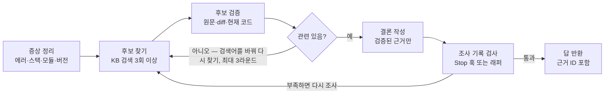
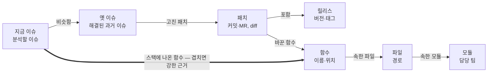

# 헤드리스 에이전트가 KB를 건너뛸 때 — 조사 절차 강제·Stop 훅·이슈 관계 그래프

대화형 세션에서는 KB(RAG·코드·MCP)를 잘 뒤지던 SW 이슈 분석 에이전트가 `claude -p`·Hermes(curl) 호출에서는 KB를 건너뛰고 끝나는 문제의 해결 지시서다. 원인은 도구 연결이 아니라 "조사는 선택"으로 여기는 모델 행동이므로, ① 필수 조사 절차와 조사 기록 답 형식 ② Stop 훅·래퍼로 조사 부족 시 종료 차단 ③ 깊이 들어가는 도구 분리 ④ 조사·분석 서브에이전트 분리 ⑤ 이슈·패치·코드 관계 그래프(가벼운 온톨로지) 순으로 적용하고, 해결된 과거 이슈 골든셋으로 단계별 전후를 측정한다. 회사 AI에 그대로 넘겨 단계별 적용을 요청하는 용도로 썼다 (회사 환경 미검증).

## 이 문서 사용법

회사 AI(Claude Code 등)에게 이 문서를 통째로 주고, 한 번에 한 단계씩 적용을 요청한다. 단계마다 "효과 측정" 시험지로 전후를 비교한 뒤 다음 단계로 넘어간다.

권장 순서는 0 → 1 → 2 → 효과 측정 → 3 → 4 → 5다. 0~2단계는 지침과 실행 설정만 바꾸고, 3~5단계는 KB 쪽 개발이 필요하다.

요청 문구 예시:

```
첨부한 문서의 "1단계"를 우리 이슈 분석 에이전트에 적용해 줘.
- 실행 방식: claude -p (또는 Hermes API) — 실제 실행 스크립트 경로: ...
- KB MCP 서버 이름: kb (실제 이름으로)
- KB 도구 이름 목록: (실제 이름으로)
바꿀 파일과 내용을 먼저 보여 주고, 내가 확인하면 적용해.
적용 후 문서의 "효과 측정" 방법으로 전후를 비교한 표를 만들어 줘.
```

이 문서의 스크립트와 명령은 회사 환경에서 시험하지 않았다. 도구 이름, 로그 형식은 실제 출력을 보고 맞춰야 한다.

## 현상과 목표

대화형 세션에서는 KB(RAG·코드·MCP)를 잘 뒤지지만, `claude -p`나 Hermes(curl) 호출에서는 KB를 건너뛰고 분석을 끝낸다. 가끔은 KB를 쓰므로 도구 연결 문제는 아니고, 모델이 KB 조사를 "해도 되고 안 해도 되는 일"로 여기는 것이 원인이다.

- 대화형에서는 사람이 "KB 봤어?" 하고 재촉하고, 결과를 보고 다시 지시한다. 한 번에 끝나는 호출에는 그 재촉이 없어서 모델이 가장 짧은 길로 간다.
- 비슷한 실측(개인 프로젝트, 2026-11-03): AI 3개에 웹 검색을 열어 주고 "검색은 선택"이라고 쓰자 2개가 검색 없이 답했다. "결정 전에 검색하고 출처를 1건 이상 적어라"로 바꾸자 3개 모두 검색했다.

목표는 사람이 이슈를 풀 듯 찾고, 깊게 확인하고, 아니면 다시 찾는 것이다. 결론에는 검증한 근거만 쓴다.



관련 후보가 없으면 검색어를 바꿔 다시 찾고, 끝내기 직전에 조사 기록을 검사해 부족하면 다시 조사로 돌려보낸다. 1단계가 절차를, 2단계가 검사를, 3단계가 '후보 검증'에 필요한 도구를 맡는다.

하지 않을 것: 검색 결과를 미리 프롬프트에 넣어 주고 끝내는 방식. 프롬프트가 길어지고, 넣은 정보가 도움이 되는지 검증 없이 끝나기 때문이다.

## 0단계 — 먼저 실제 호출 기록 보기

바꾸기 전에 지금 호출이 KB 도구를 몇 번 부르는지 기록으로 확인한다. 이 숫자가 이후 단계의 비교 기준이다.

`claude -p`:

```bash
claude -p "<이슈 분석 프롬프트>" --output-format stream-json --verbose > run.jsonl

# 첫 줄(init): 불러온 도구 수와 MCP 서버 연결 상태
head -1 run.jsonl | jq '{tools: (.tools | length), mcp: .mcp_servers}'

# 부른 도구 이름별 횟수
jq -r 'select(.type=="assistant") | .message.content[]? | select(.type=="tool_use") | .name' run.jsonl | sort | uniq -c
```

Hermes:

```bash
hermes chat -q "<이슈 분석 프롬프트>" -Q --format stream-json > run.jsonl
```

Hermes 이벤트 형식은 버전마다 다를 수 있어, jq 필터는 실제 출력을 보고 맞춘다.

이슈 5~10건으로 다음을 기록한다.

- KB 검색 횟수
- 원문·diff를 연 횟수
- 걸린 시간
- 결론이 맞았는지

MCP 서버가 failed로 나오거나 도구 결과에 권한 거부가 보이면 설정 문제다. 그때는 `--mcp-config kb.json --allowedTools "mcp__kb__*"`를 먼저 지정한다. MCP 토큰은 명령줄 인자로 넘기면 `ps`에 노출되니 파일이나 환경변수로 넘긴다.

## 1단계 — 조사 절차와 답 형식을 필수로

시스템 프롬프트에 조사 절차를 필수 단계로 적고, 답에 조사 기록을 반드시 남기게 한다. 이 기록이 있어야 2단계에서 코드로 검사할 수 있다.

시스템 프롬프트 예시 (`procedure.md`):

```
당신은 SW 이슈 분석가다. 결론보다 근거가 먼저다. 아래 절차를 건너뛰면 분석은 무효다.

1. 증상 정리: 에러 메시지 원문, 스택트레이스의 함수·파일, 모듈, 버전, 재현 조건을 뽑는다.
2. 후보 찾기: KB 를 최소 3번, 서로 다른 검색어로 검색한다.
   ① 에러 메시지 원문  ② 함수·파일·모듈 이름  ③ 증상을 풀어 쓴 문장
3. 후보 검증: 상위 후보마다 원문을 열고, 고친 패치가 있으면 diff 를 연다.
   판정 기준(아래 표)으로 관련 있음 / 부분 관련 / 무관 을 정하고 이유를 한 줄로 쓴다.
4. 다시 찾기: '관련 있음'이 없으면 검색어를 바꿔 2번으로 돌아간다 (최대 3라운드).
5. 결론: '관련 있음'으로 판정한 근거만 쓴다.
   근거가 없으면 "KB 에 유사 사례 없음"과 시도한 검색어를 쓴다.
```

후보 판정 기준:

| 기준 | 확인 방법 |
| --- | --- |
| 같은 에러·스택인가 | 에러 원문, 스택트레이스의 함수 비교 |
| 같은 코드 위치인가 | 옛 패치가 바꾼 파일·함수가 지금 이슈의 스택·코드 경로에 있는지 |
| 지금 코드에 이미 들어갔나 | 옛 패치가 현재 브랜치에 있는지. 있다면 재발·회귀를 의심 |
| 조건이 맞나 | 버전, 설정, 하드웨어·환경 |

답 형식 (JSON):

```json
{
  "symptom": {"error": "...", "functions": ["..."], "module": "...", "version": "..."},
  "research_log": [
    {"round": 1, "query": "...", "candidate": "ISSUE-1234",
     "opened": ["issue", "patch-diff"], "verdict": "relevant | partial | unrelated", "reason": "..."}
  ],
  "kb_refs": ["ISSUE-1234", "commit abc123"],
  "analysis": "...",
  "confidence": "high | medium | low"
}
```

MCP 도구 설명도 고친다. 모델은 도구 설명을 보고 호출 여부를 정한다. 예: `search_issues` — "과거 이슈·장애 기록 검색. 이슈 분석을 시작할 때 항상 먼저 호출. 에러 메시지 원문으로 검색하면 정확하다."

적용 위치:

- `claude -p`: `--append-system-prompt "$(cat procedure.md)"`
- Hermes: 프로필 페르소나(SOUL) 파일이나 스킬(`-s`)

## 2단계 — 조사가 부족하면 끝내지 못하게

1단계 지침만으로는 여전히 가끔 건너뛴다. 모델이 끝내려는 순간 실제 도구 호출 기록을 코드로 검사하고, 부족하면 이어서 조사하게 한다. 대화형에서 사람이 하던 재촉을 코드가 대신하는 것이다.

검사 조건 (두 경로 공통, 숫자는 효과 측정 보고 조정):

- KB 검색 도구 호출 3회 이상
- 후보 원문이나 diff를 연 호출 1회 이상
- `kb_refs`의 ID는 실제로 열어 본 것만 (열지 않은 ID를 인용하면 지어낸 근거로 본다)

**`claude -p` 경로: Stop 훅**

```bash
#!/bin/bash
# require-research.sh — 조사가 부족하면 종료를 1번 막는다
input=$(cat)
[ "$(jq -r .stop_hook_active <<<"$input")" = "true" ] && exit 0   # 이미 한 번 막았으면 통과 (무한 반복 방지)
t=$(jq -r .transcript_path <<<"$input")
names=$(jq -r 'select(.type=="assistant") | .message.content[]? | select(.type=="tool_use") | .name' "$t")
search=$(grep -cE '^mcp__kb__(search_issues|search_patches)' <<<"$names")   # 실제 도구 이름으로
opened=$(grep -cE '^mcp__kb__(get_issue|get_patch)' <<<"$names")
[ "$search" -ge 3 ] && [ "$opened" -ge 1 ] && exit 0
jq -n --arg r "KB 조사가 부족합니다 (검색 ${search}회, 원문·diff 확인 ${opened}회). 검색어를 바꿔 3회 이상 검색하고, 상위 후보의 원문과 패치 diff를 열어 판정한 뒤 다시 결론을 쓰세요." '{decision:"block", reason:$r}'
```

이 에이전트 전용 설정 파일(`issue-agent-settings.json`):

```json
{"hooks": {"Stop": [{"hooks": [{"type": "command", "command": "/경로/require-research.sh"}]}]}}
```

실행: `claude -p --settings issue-agent-settings.json --append-system-prompt "$(cat procedure.md)" ...`. hooks를 끄는 설정(`disableAllHooks`)은 넣지 않는다.

**Hermes·curl 경로: 래퍼가 검사하고 같은 세션에서 이어서 묻기**

1. `--format stream-json`(Hermes) 또는 `--output-format stream-json`(claude)으로 실행하고 도구 호출 수를 센다.
2. 조건 미달이면 같은 세션에 부족한 점을 담아 이어서 묻는다. 처음부터 다시 돌리지 않아서 비용이 적다.
    - Hermes: `hermes chat --resume <세션ID> -q "KB 검색 1회, diff 확인 0회로 끝났습니다. 절차 2~4를 마친 뒤 다시 결론을 쓰세요." -Q`
    - claude: `claude -p --resume <세션ID> "..."`
3. 이어서 묻기는 최대 2번. 그래도 부족하면 결과에 "조사 부족" 표시를 붙여 낸다.

## 3단계 — 깊이 들어가는 도구로 나누기

검색 도구 하나로는 "깊게 보기"가 안 된다. 사람이 하듯 열어 보고 따라갈 수 있도록 도구를 나눈다. 검색은 짧은 목록(ID + 한 줄)만 돌려주고, 원문은 열기 도구로 본다. 그래야 모델이 고른 것만 깊게 읽고 컨텍스트도 아낀다.

| 도구 | 하는 일 | 쓰는 단계 |
| --- | --- | --- |
| `search_issues(query, filters)` | 과거 이슈 검색 (의미 + 키워드). ID·제목·한 줄 요약 | 후보 찾기 |
| `search_patches(query, path?)` | 패치(커밋·MR) 검색 | 후보 찾기 |
| `get_issue(id)` | 이슈 원문, 원인·해결 요약, 연결된 패치 ID | 검증 |
| `get_patch(id)` | diff 원문, 바꾼 파일·함수, 커밋 메시지, 들어간 릴리스 | 검증 |
| `history(path 또는 symbol, since?)` | 그 파일·함수를 바꾼 패치 목록, 최신순 | 검증·회귀 확인 |
| `co_changed(path)` | 같은 커밋에서 자주 함께 바뀐 파일 | 사이드 이펙트 확인 |
| `current_code(path, symbol?)` | 지금 브랜치의 코드 | "이미 들어갔나" 확인 |

검색은 의미 검색과 키워드 검색을 함께 쓴다. 에러 코드나 함수 이름은 키워드 검색이 훨씬 정확하다.

## 4단계 — 조사 담당과 분석 담당 나누기

긴 diff와 코드를 한 대화에 다 넣으면 컨텍스트가 넘치고 판단이 흐려진다. 조사 담당 서브에이전트가 읽고 검증해서, 분석 담당에게는 짧은 결과만 넘긴다. 프롬프트가 길어지는 문제는 이 단계에서 풀린다.

1. 분석 담당(메인): 증상을 정리하고 가설 2~3개를 세운다.
2. 가설마다 조사 담당을 부른다. 여러 개를 동시에 돌려도 된다.
3. 조사 담당: 1단계 절차의 2~4번(찾기·검증·다시 찾기)만 하고, 판정 목록과 핵심 diff 몇 줄만 돌려준다.
4. 분석 담당: '관련 있음' 근거만 모아 결론을 쓴다.

Claude Code 서브에이전트 정의 예시 (`.claude/agents/kb-researcher.md`):

```markdown
---
name: kb-researcher
description: 가설 하나에 대해 KB에서 유사 이슈·패치를 찾고 깊게 검증해, 검증된 근거만 짧게 돌려준다
tools: mcp__kb__search_issues, mcp__kb__search_patches, mcp__kb__get_issue, mcp__kb__get_patch, mcp__kb__history, mcp__kb__current_code
---
가설과 증상을 받는다. 찾기 → 검증 → 다시 찾기만 한다 (최대 3라운드).
돌려줄 것: 판정한 후보 목록(ID, 판정, 이유 한 줄)과 '관련 있음' 후보의 핵심 diff 몇 줄.
원문 전체는 돌려주지 않는다.
```

- `claude -p`에서는 메인 지침에 "가설마다 kb-researcher에게 맡겨라"를 넣고, 서브에이전트 호출 도구(버전에 따라 `Agent` 또는 `Task`)를 `--allowedTools`에 넣는다.
- Hermes는 서브에이전트 위임(`delegate_task`)으로 같은 구조를 만든다.
- 2단계 검사는 조사 담당이 돌려준 판정 수로도 할 수 있다.

## 5단계 — 가벼운 온톨로지 (이슈·패치·코드 관계 그래프)

이슈 KB를 객체와 관계로 정리하면, "옛 이슈 → 고친 패치 → 바꾼 함수 → 지금 이슈 스택에 있나"를 한 단계씩 따라가며 검증할 수 있다. 벡터 검색이 "비슷한 글"까지만 찾는 한계를 메운다.

팔란티어의 온톨로지는 회사 데이터를 업무 단위의 객체(예: 고객·설비)와 속성, 관계(링크), 허가된 행동(액션)으로 정의한 의미 계층이다. 사람과 AI가 같은 객체 위에서 조회하고 실행한다. 핵심은 "스키마가 있는 지식 그래프 + 권한 + 행동"이고, 여기서는 제품 전체가 아니라 작은 스키마와 탐색 도구만 필요하다. (개념 설명은 공개된 일반 설명 기준)



지금 이슈 스택에 나온 함수와 옛 패치가 바꾼 함수가 겹치면 강한 근거다. 그 패치가 이미 들어간 릴리스에서 다시 났다면 회귀를 의심한다.

객체:

| 객체 | 주요 속성 | 가져올 곳 |
| --- | --- | --- |
| 이슈 | ID, 제목, 증상, 에러 시그니처, 버전, 원인 요약 | 이슈 트래커 |
| 패치 | 커밋·MR ID, 메시지, 날짜, diff | git |
| 파일 | 경로 | git 트리 |
| 함수 | 이름, 파일, 위치 | 코드 파서 (ctags, tree-sitter) |
| 모듈 | 이름, 담당 | 디렉터리 규칙, CODEOWNERS |
| 릴리스 | 버전, 날짜 | git 태그 |

관계와 자동 추출 방법:

| 관계 | 만드는 법 |
| --- | --- |
| 이슈 → 고친 패치 | 커밋 메시지·MR의 이슈 키, 이슈 트래커의 연결 필드 |
| 패치 → 바꾼 파일·함수 | git diff의 변경 구간을 파서로 함수에 매핑 |
| 함수 → 파일 → 모듈 | 파서, 경로 규칙 |
| 패치 → 들어간 릴리스 | `git tag --contains <커밋>` |
| 파일 ↔ 함께 바뀐 파일 | co-change 통계 (같은 커밋에서 함께 바뀐 비율) |
| 이슈 → 언급된 함수·에러 | 스택트레이스·로그 정규식 |
| 이슈 ↔ 비슷한 이슈 | 임베딩 유사도. 후보일 뿐 확정이 아니다 |

만드는 순서:

1. 이슈↔패치 연결률부터 잰다. 커밋 메시지에 이슈 키 규칙이 지켜진 비율이 낮으면 나머지가 힘을 못 쓴다.
2. 패치 → 파일·함수, 패치 → 릴리스를 자동으로 만든다.
3. co-change 통계를 더한다.
4. 이슈 → 함수·에러를 더한다.
5. `neighbors(id, 관계)` 도구를 3단계 도구와 함께 노출한다. 예: `neighbors('ISSUE-1234', 'fixed_by')`.

저장은 처음에 Postgres나 SQLite의 두 표면 충분하다: `nodes(id, type, props)`, `edges(src, rel, dst)`. pgvector를 쓰고 있으면 같은 DB에 둔다. 코드 구조 그래프는 기존 도구(예: graphify)로 시작할 수 있다.

어려운 점은 세 가지다.

- 연결 품질: 이슈와 패치의 연결은 커밋 메시지 규칙에 달려 있다.
- 신선도: 머지 파이프라인에서 증분 갱신해야 그래프가 최신 코드를 따라간다.
- LLM으로 뽑은 흐릿한 속성(원인 분류 등)은 '추정'으로 표시하고, 단독 근거로 쓰지 않는다.

## 효과 측정

이미 해결된 과거 이슈로 시험지를 만들고, 단계를 적용할 때마다 같은 시험지로 전후를 비교한다. 시험지 없이 느낌으로 판단하면, 어느 단계가 효과가 있었는지 알 수 없다.

- 시험지: 해결된 이슈 20~30건(모듈·유형을 섞어서). 정답은 실제 원인과 고친 패치 ID다.
- 커닝 방지: 시험할 때는 그 이슈 자체와 그 이후에 생긴 데이터를 KB 검색에서 뺀다 (날짜 필터).

| 지표 | 보는 것 |
| --- | --- |
| KB 검색 수, 원문·diff를 연 수 | 조사를 했나 |
| 정답 패치가 후보 상위 5개에 있었나 | 찾기 품질 |
| 정답을 '관련 있음'으로 판정했나 | 검증 품질 |
| 무관한 근거를 '관련 있음'으로 쓴 비율 | 잘못된 근거 |
| 원인 결론이 맞았나 (사람이 채점) | 최종 품질 |
| 걸린 시간, 토큰 | 비용 |

강제 조건을 너무 높이면 형식적인 검색으로 채울 수 있다. 그래서 '검색 수'만 보지 말고 '잘못된 근거' 비율을 함께 본다.

## 부록 — Hermes CLI 메모와 주의사항

Hermes 명령은 개인 Mac에 설치된 버전의 도움말(2026-11) 기준이다. 회사 버전은 `hermes --help`로 확인한다.

| 명령 | 용도 |
| --- | --- |
| `hermes -z "프롬프트"` (`--oneshot`) | 한 번 묻고 최종 답만 출력. `claude -p`에 해당 |
| `hermes chat -q "질문" -Q --format stream-json` | 프로그램용. 도구 호출 이벤트까지 받음 |
| `hermes chat --resume <세션ID> -q "..."` | 같은 세션에 이어서 묻기 |
| `-t` / `-s` / `--reasoning` | 도구 묶음 지정 / 스킬 미리 불러오기 / 추론 강도 |
| `hermes profile` | 프로필 관리. 이 버전 도움말에는 `-p` 옵션이 없다 |

주의사항:

- Stop 훅의 대화 기록(transcript) 형식, 도구 이름, stream-json 이벤트 형식은 실제 출력으로 확인한 뒤 스크립트를 맞춘다.
- Stop 훅은 1번만 막는다(`stop_hook_active`). 더 여러 번 막으려면 래퍼에서 이어서 묻기 횟수를 관리한다.
- 조사가 길어지면 호출당 시간이 늘어난다. 게이트웨이·curl의 제한 시간과 `--max-turns`를 넓혀 검색 도중에 끊기지 않게 한다.
- 모델과 추론 강도는 대화형에서 쓰는 것과 같게 지정한다. 다르면 비교가 되지 않는다.

## 관련 맥락

- [[code-change-rag-kb-spec]] — 같은 KB 개선 작업 지시서. 다단계 절차 지침(Task 3)·출처 인용 강제(Task 9)가 이 문서 1·2단계와 같은 방향
- [[code-change-rag-kb-design]] — 도구 분리(①)·co-change(③)·코드 그래프(⑧) 권고. 3·5단계의 근거
- [[hermes-agent]] — Hermes CLI·API 서버·Runs API·delegate_task
- [[agentic-cli-text-generation-lockdown]] — 반대 방향 패턴: 에이전트 CLI 를 도구 없는 텍스트 생성기로 잠글 때
- [[hermes-single-model-delegation]] — 서브에이전트 위임과 컨텍스트 부패

## 변경 이력

- 2026-11-03: 최초 생성 — 헤드리스 호출의 KB 스킵 원인(재촉 부재), 절차·답 형식, Stop 훅 스크립트, 이어서 묻기, 도구 분리, 서브에이전트, 가벼운 온톨로지, 골든셋 측정, Hermes CLI 메모 (출처: 이 세션 대화, ai_arena 웹 검색 "선택→필수" 실측)
