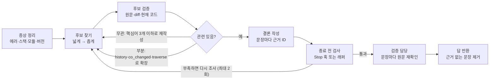
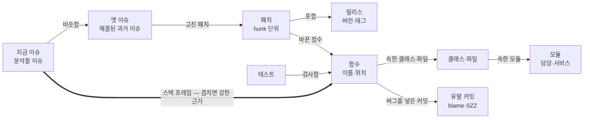

# 헤드리스 에이전트가 KB를 건너뛸 때 — 실행 설정 진단·조사 절차 강제·Stop 훅·이슈 관계 그래프

대화형 세션에서는 KB(코드 레포·과거 패치·과거 이슈, RAG·MCP)를 잘 뒤지던 SW 이슈 분석 에이전트가 `claude -p`·Hermes(curl) 호출에서는 KB를 건너뛰거나 가끔만 쓰고, 결과 품질도 떨어지는 문제의 해결 지시서다. 먼저 의심할 것은 모델 성향이 아니라 **headless 에서만 달라지는 실행 설정**이다: Opus 5.5 의 effort 기본값 `medium`, MCP 도구 지연 로드와 짧은 연결 대기, 허용 목록 밖 도구의 자동 거부, 오래 걸린 MCP 호출 결과의 소실. 이것들은 "가끔은 KB 를 쓴다"는 증상과도 맞는다. 그다음이 대화형에서 사람이 주던 맥락·재촉의 부재이며, 이는 조사 절차·종료 전 검사·검증 담당·도구 설계·관계 그래프로 메운다. 해결된 과거 이슈 시험지로 단계별 전후를 측정한다. (회사 환경 미검증. 문서 내용은 2026-11 기준 공식 문서·논문 확인)

## 이 문서 사용법

회사 AI(Claude Code 등)에게 이 문서를 통째로 주고, 한 번에 한 단계씩 적용을 요청한다. 단계마다 "효과 측정" 시험지로 전후를 비교한 뒤 다음 단계로 넘어간다.

권장 순서: **0 진단 → 1 실행 설정** → 효과 측정 → 2 절차 → 3 종료 전 검사 → 효과 측정 → 4 도구 → 5 조사·검증 담당 → 6 관계 그래프. 0~3단계는 설정·지침·훅만 바꾸고, 4~6단계는 KB 쪽 개발이 필요하다. **0·1단계만으로 크게 나아질 수 있으니 건너뛰지 않는다.**

요청 문구 예시:

```
첨부한 문서의 "0단계"와 "1단계"를 우리 이슈 분석 에이전트에 적용해 줘.
- 실행 방식: claude -p (또는 Hermes API) — 실제 실행 스크립트 경로: ...
- KB MCP 서버 이름: kb (실제 이름으로), KB 도구 이름 목록: (실제 이름으로)
- 대화형에서 잘 됐던 세션의 transcript 경로: ...
바꿀 파일과 내용을 먼저 보여 주고, 내가 확인하면 적용해.
적용 후 문서의 "효과 측정" 방법으로 전후를 비교한 표를 만들어 줘.
```

## 현상과 목표

대화형에서는 KB를 잘 뒤지지만 headless 호출에서는 건너뛰거나 가끔만 쓰고, 결과물 품질도 떨어진다. 목표는 사람이 이슈를 풀 듯 찾고, 깊게 확인하고, 아니면 다시 찾는 것이다. 결론에는 검증한 근거만 쓴다.



하지 않을 것: 검색 결과를 넣어 주기만 하고 판정 없이 끝내는 방식. 아래 '전략 판단'의 후보 강제는 판정 의무·추가 탐색·종료 전 검사가 함께 붙는다는 점이 다르다.

## 전략 판단 — KB 를 계속 쌓는 게 맞나

방향은 맞다. 과거 해결 사례의 재사용은 효과가 확인됐다: Microsoft RCACopilot(비슷한 과거 장애 재사용, 원인 분류 정확도 0.766), BugLocator(비슷한 과거 버그가 고친 파일), HAFix(수정 이력 활용 +45~50%), SWE-Exp(과거 해결 기록 재사용). 다만 "KB 가 쌓이면 에이전트가 자연히 좋아진다"는 전제는 두 군데서 끊긴다.

1. **쓸지 말지를 AI 에게 맡김** — AI 가 말하는 "중요하지 않아서 건너뛰었다"는 사후 설명일 가능성이 크다 (effort medium, 도구 미로드, 선택 사항으로 읽히는 지침이 실제 원인일 수 있음). KB 조회를 **파이프라인 단계로** 바꾼다: 이슈가 들어오면 코드가 먼저 에러 시그니처·스택 함수로 KB 를 조회해 후보 5~10건을 만들고, AI 는 후보마다 판정을 반드시 남기며 필요하면 더 찾는다. 성능 좋은 시스템도 대부분 "검색·재정렬로 후보 → 에이전트 검증" 구조다 (Agentless, SweRank, Meta RCA).
2. **쌓이는 내용의 형태** — 크기만 늘면 잡음이 늘고, 쓸모없는 결과를 몇 번 본 AI 는 KB 를 건너뛴다. 사람이 해결한 이슈는 사례 카드로 쌓는다:

| 칸 | 내용 |
| --- | --- |
| 증상 | 에러 메시지 원문, 스택 함수, 버전·환경 |
| 원인 | 한두 문장 + 확인 근거 |
| 수정 | 고친 패치 ID, 바뀐 함수, 버그를 넣은 커밋(알면) |
| 진단 경로 | 사람이 어떻게 찾았나, 무엇을 배제했나 — 에이전트에게 "사람처럼 푸는 법"을 주는 부분 |
| 검증 | 사람이 확인했나 / 추정인가 |

**지금 방식이 맞는지는 실험으로 판단한다** (시험지 20~30건, '효과 측정' 절의 방법으로):

| 조건 | 내용 | 해석 |
| --- | --- | --- |
| A | KB 없이 | 기준 |
| B | 지금처럼 KB 사용은 선택 | B ≈ A 면 지금 KB 는 사실상 안 쓰이는 것 |
| C | 후보 강제 + 판정 의무 | C ≫ A 면 KB 투자는 맞고 소비 구조가 문제. C ≈ A 면 KB 내용·검색 품질 문제 → 더 쌓기 전에 카드 형식·검색부터 |

지표는 문서 수가 아니라 **답에 KB 가 인용된 비율과 인용된 근거가 맞았는지**다 (이 llm_wiki 의 성공 기준과 같은 원칙).

## 왜 headless 가 대화형보다 못한가 — 문서로 확인된 차이

품질 차이를 직접 설명하는 공식 문서는 없다. 아래는 문서화된 **동작 차이**이며, 하나씩 켜고 끄며 효과 측정으로 확인한다.

| # | 차이 | 증상 | 확인 방법 | 고치는 법 |
| --- | --- | --- | --- | --- |
| 1 | Opus 5.5 effort 기본 `medium`. 문서: "Lower effort also means fewer and terser tool calls" | 도구 호출이 적고 답이 짧음 | 대화형에서 `/effort` 를 올려 썼는지 확인 | `--effort high` (또는 `xhigh`), `CLAUDE_CODE_EFFORT_LEVEL`. settings 의 top-level `effortLevel` 은 Opus 5.5 에 안 먹음 |
| 2 | MCP tool search 기본 — 세션 시작 시 도구 이름·서버 안내문만 로드. 설정 파일 서버는 첫 턴 전 약 2초만 대기 | **KB 도구가 있을 때도 없을 때도 있음 (간헐)** | init 이벤트 `mcp_servers[].status` 가 `connected` 인지 | KB 서버에 `alwaysLoad: true`, `--mcp-config` 로 넘기고 `MCP_TIMEOUT` 상향, 연결 안 됐으면 실행 실패 처리 |
| 3 | `-p` 기본 권한 모드는 manual — 허용 규칙 없는 MCP·Bash(`git log` 등) 호출은 거부 | KB·git 이력을 못 보고 추측으로 답함 | 최종 `result` 의 `permission_denials`, `permission_denied` 이벤트 | `--allowedTools "mcp__kb__*" "Bash(git log *)" ...` |
| 4 | 오래 걸리는 MCP 호출은 자동 백그라운드로 밀리고, `-p` 에서는 그 결과가 사라질 수 있음 | 느린 RAG 질의 결과 없이 진행 | stream-json 에서 tool_use 뒤 결과 유무 | `CLAUDE_CODE_MCP_AUTO_BACKGROUND_MS=0` |
| 5 | 대화형에서 사람이 주던 맥락(버전·브랜치·의심 모듈)과 재촉이 없음. Claude 는 요청을 보수적으로 읽는 경향 | 조사 범위가 좁음 | 0단계 transcript 비교 | 2단계 절차 + 필수 입력 고정 |
| 6 | 로딩 범위: CLAUDE.md·agents·skills·`.mcp.json` 은 cwd 기준. `--bare` 는 이들을 모두 건너뛰며 `-p` 기본이 될 예정 | 서버 cwd 에서 지침·서브에이전트가 안 보임 | init 이벤트의 tools·agents | `--settings`·`--mcp-config`·`--agents`·`--append-system-prompt` 로 명시 (`--system-prompt` 는 기본 프롬프트를 통째로 교체하므로 쓰지 않음) |

Hermes(curl) 경로는 Hermes 자체 에이전트 루프라 위 표가 그대로 적용되지 않는다. Hermes 가 내부에서 `claude -p` 를 부른다면(claude-code skill) 그 하위 호출에 1단계 옵션을 넣고, 아니라면 Hermes 의 도구 묶음(`-t`)·추론 강도(`--reasoning`)·프로세스의 cwd·HOME·환경변수가 대화형과 같은지 본다.

## 0단계 — 진단: 실행 기록과 잘 된 대화 비교

**실행마다 네 가지를 기록**한다. 이 숫자가 이후 단계의 비교 기준이다.

```bash
claude -p "<이슈 분석 프롬프트>" --output-format stream-json --verbose > run.jsonl

# ① KB 서버 연결 상태 (connected 여야 함)
jq -r 'select(.type=="system" and .subtype=="init") | .mcp_servers[] | "\(.name)=\(.status)"' run.jsonl
# ② 부른 도구 이름별 횟수
jq -r 'select(.type=="assistant") | .message.content[]? | select(.type=="tool_use") | .name' run.jsonl | sort | uniq -c
# ③ 권한 거부 (비어 있어야 함) · ④ 종료 사유와 턴 수
jq -c 'select(.type=="result") | {subtype, num_turns, total_cost_usd, permission_denials}' run.jsonl
```

Hermes: `hermes chat -q "<프롬프트>" -Q --format stream-json > run.jsonl` (이벤트 형식은 버전마다 다르니 jq 필터는 실제 출력을 보고 맞춘다).

**잘 된 대화형 transcript 와 headless transcript 를 비교**한다. 같은 이슈로 두 기록을 Claude 에게 주고 다음을 뽑게 한다.

- 도구 호출 순서·횟수의 차이 (어디서 headless 가 멈췄나)
- 대화형에서 **사람이 끼어든 지점**과 그때 준 정보 (버전, 브랜치, 의심 모듈, "그 패치 봤어?" 같은 재촉)

뽑힌 정보는 2단계의 필수 입력과 절차로 옮긴다. 사람이 무의식적으로 주던 맥락이 headless 품질 차이의 큰 몫일 수 있다.

## 1단계 — 실행 설정을 대화형 수준으로

```bash
MCP_TIMEOUT=60000 CLAUDE_CODE_MCP_AUTO_BACKGROUND_MS=0 \
claude -p --model claude-opus-5-5 --effort high \
  --mcp-config kb.json --strict-mcp-config \
  --allowedTools "mcp__kb__*" "Read" "Grep" "Glob" "Bash(git log *)" "Bash(git show *)" "Bash(git blame *)" \
  --settings issue-agent-settings.json \
  --append-system-prompt "$(cat procedure.md)" \
  --output-format stream-json --verbose "<이슈 본문>" > run.jsonl
```

`kb.json` — KB 도구를 지연 로드하지 않게 한다:

```json
{"mcpServers": {"kb": {"command": "<KB 서버 실행 명령>", "args": ["..."], "alwaysLoad": true}}}
```

래퍼는 실행 후 0단계 ①·③을 검사해 **KB 가 connected 가 아니거나 permission_denials 가 있으면 실패로 보고 재실행**한다. 결과를 그대로 쓰지 않는다.

- 도구 설명은 4,096자(지연 로드 도구는 16,384자)에서 잘리므로 핵심("이슈 분석 시작 시 항상 먼저 호출")을 앞에 쓴다. MCP 서버 안내문(server instructions)에도 같은 문장을 넣는다.
- effort 는 `medium`/`high`/`xhigh` 를 효과 측정으로 비교해 정한다 (비용·시간도 함께 본다).
- MCP 토큰은 명령줄 인자로 넘기면 `ps` 에 노출되니 파일이나 환경변수로 넘긴다.

## 2단계 — 조사 절차와 답 형식

강조어("건너뛰면 무효")를 쌓기보다 **이유를 설명**한다. 강조가 많으면 Claude 가 규칙을 과하게 적용한다는 것이 Anthropic 가이드다. Opus 5.5 가이드의 "행동 전에 도구로 넓게 조사하라" 지시는 정답률을 눈에 띄게 올렸다고 보고된다.

시스템 프롬프트 예시 (`procedure.md`):

```
당신은 SW 이슈 분석가다. 이 분석은 사람이 다시 확인하지 않고 쓰이므로, 결론은 KB 와 코드에서 직접 확인한 근거로만 세운다.
결론을 내리기 전에 도구로 넓게 조사하라. 이슈에 직접 적히지 않은 관련 이슈·패치·코드도 포함한다.
원인 가설을 2~3개 세우고, 근거를 찾을 때마다 각 가설의 확신도를 갱신한다.

1. 증상 정리: 에러 메시지 원문, 스택트레이스의 함수·파일(프로젝트 프레임 우선), 모듈, 버전, 재현 조건.
2. 후보 찾기: 입력으로 받은 KB 후보는 하나도 빠짐없이 판정한다. 그 외에 서로 다른 검색어로 최소 3번. ① 에러 원문 ② 함수·파일·모듈 이름 ③ 증상을 풀어 쓴 문장. 처음엔 넓게, 그다음 좁힌다.
3. 후보 검증: 도구 결과를 받을 때마다 관련성을 평가한다. 상위 후보는 원문과 패치 diff 를 열고 판정 기준으로 판정한다.
4. 판정에 따른 다음 행동 (최대 3라운드):
   - 모두 무관 → 다른 관점의 핵심어 3개 이하로 검색어를 다시 쓴다
   - 부분 관련 → history·co_changed·traverse 로 주변을 넓힌다
   - 관련 있음 → 스택 함수와 겹치는 diff 줄만 뽑아 둔다
   - 후보 패치에서 새로 나온 함수·파일 이름은 다음 검색어로 쓴다
5. 결론: '관련 있음' 근거만 쓴다. 결론 문장마다 근거 ID 를 단다.
   근거가 없으면 "KB 에 유사 사례 없음"과 시도한 검색어를 쓴다. 없는 것을 있다고 하지 않는다.
```

필수 입력 (0단계 비교에서 사람이 주던 것): 제품·버전, 브랜치, 재현 환경, 의심 모듈(알면). 없으면 "모름"으로 명시해 넘긴다.

조사 규모 기준 (Anthropic 연구 시스템의 규칙을 이슈 분석에 맞춘 것):

| 이슈 | 예산 |
| --- | --- |
| 에러·스택이 명확, 모듈 하나 | 검색·열기 합계 5~10회, 서브에이전트 없음 |
| 원인 불명, 여러 모듈 | 가설 2~4개, 가설마다 조사 담당 1개 × 10~15회 |

후보 판정 기준:

| 기준 | 확인 방법 |
| --- | --- |
| 같은 에러·스택인가 | 에러 원문, 스택 프레임 함수 비교 (깊은 프레임·라이브러리 프레임은 가중 낮게) |
| 같은 코드 위치인가 | 옛 패치가 바꾼 파일·함수가 지금 스택·코드 경로에 있는지 |
| 지금 코드에 이미 들어갔나 | 옛 패치가 현재 릴리스에 있는지. 있다면 재발·회귀 → 그 이후 그 함수를 바꾼 커밋(`blame`·`history`) 확인 |
| 조건이 맞나 | 버전, 설정, 하드웨어·환경 |

답 형식 (JSON) — `claims` 는 5단계 검증 담당이 쓴다:

```json
{
  "inputs": {"version": "...", "branch": "...", "suspect_module": "모름"},
  "symptom": {"error": "...", "frames": ["..."], "module": "..."},
  "hypotheses": [{"text": "...", "confidence": "high | medium | low"}],
  "research_log": [
    {"round": 1, "query": "...", "candidate": "ISSUE-1234", "opened": ["issue", "patch-diff"],
     "verdict": "relevant | partial | unrelated", "reason": "...", "next_action": "..."}
  ],
  "claims": [{"text": "원인은 ...", "refs": ["ISSUE-1234", "abc123"]}],
  "kb_refs": ["ISSUE-1234", "abc123"],
  "confidence": "high | medium | low"
}
```

`kb_refs`·`refs` 의 ID 는 `get_issue`·`get_patch` 에 넘긴 ID 와 같은 표기로 쓰게 한다 (3단계 검사에서 대조).

## 3단계 — 끝내기 전 검사 (Stop 훅·래퍼)

모델이 끝내려는 순간 **실제 도구 호출 기록**을 코드로 검사하고, 부족하면 이어서 조사하게 한다. 대화형에서 사람이 하던 재촉을 코드가 대신한다. 공식 문서 기준 사항:

- transcript 파일은 비동기로 기록돼 마지막 턴이 늦게 반영될 수 있다 → **PostToolUse 훅으로 KB 호출을 직접 기록**하고 Stop 훅은 그 기록을 본다. 마지막 답은 Stop 입력의 `last_assistant_message` 로 본다.
- Stop 훅 연속 차단은 기본 8회까지(`CLAUDE_CODE_STOP_HOOK_BLOCK_CAP`, 도구 호출 시 리셋). Opus 5.5 가이드는 자동 계속을 **2~3회에서 멈추라**고 권한다 → 아래 스크립트는 세션당 2회.

PostToolUse 기록기 (`log-kb-calls.sh`):

```bash
#!/bin/bash
# KB 도구 이름과 대상 ID 를 세션별 파일에 기록 (transcript 지연을 피해 직접 남긴다)
input=$(cat)
sid=$(jq -r .session_id <<<"$input")
jq -r '[.tool_name, (.tool_input.id // .tool_input.issue_id // .tool_input.patch_id // "")] | @tsv' \
  <<<"$input" >> "/tmp/kb-research-$sid.log"
```

Stop 훅 (`require-research.py`):

```python
#!/usr/bin/env python3
"""조사가 부족하거나, 열어 보지 않은 ID 를 인용하면 종료를 막는다 (세션당 최대 2회)."""
import json, re, sys
from pathlib import Path

inp = json.load(sys.stdin)
log = Path(f"/tmp/kb-research-{inp['session_id']}.log")
blocks = Path(f"/tmp/kb-research-{inp['session_id']}.blocks")
n_blocks = int(blocks.read_text()) if blocks.exists() else 0
if n_blocks >= 2:
    sys.exit(0)  # 2번 막고도 부족하면 통과시키고, 래퍼가 결과에 '조사 부족'을 표시

calls = [line.split("\t") for line in log.read_text().splitlines()] if log.exists() else []
search = sum(1 for c in calls if c[0].startswith("mcp__kb__search_"))       # 실제 도구 이름으로
opened = {c[1] for c in calls if c[0].startswith("mcp__kb__get_") and len(c) > 1 and c[1]}

refs = set()
m = re.search(r'"kb_refs"\s*:\s*(\[[^\]]*\])', inp.get("last_assistant_message") or "")
if m:
    try:
        refs = set(json.loads(m.group(1)))
    except ValueError:
        pass

problems = []
if search < 3:
    problems.append(f"KB 검색 {search}회 (3회 이상 필요)")
if not opened:
    problems.append("후보 원문·diff 를 하나도 열지 않음")
if refs - opened:
    problems.append("열어 보지 않은 ID 인용: " + ", ".join(sorted(refs - opened)))
if not problems:
    sys.exit(0)
blocks.write_text(str(n_blocks + 1))
print(json.dumps({"decision": "block", "reason": "조사가 부족합니다 — " + "; ".join(problems)
                  + ". 절차 2~4를 마친 뒤 실제로 연 자료만 kb_refs 에 넣어 다시 결론을 쓰세요."}, ensure_ascii=False))
```

이 에이전트 전용 설정 (`issue-agent-settings.json`):

```json
{"hooks": {
  "PostToolUse": [{"matcher": "mcp__kb__.*", "hooks": [{"type": "command", "command": "/경로/log-kb-calls.sh"}]}],
  "Stop": [{"hooks": [{"type": "command", "command": "/경로/require-research.py"}]}]
}}
```

hooks 를 끄는 설정(`disableAllHooks`)이나 `--bare` 는 쓰지 않는다.

**Hermes·curl 경로: 래퍼가 검사하고 같은 세션에서 이어서 묻기**

1. stream-json 으로 실행하고 위와 같은 조건(검색 수, 연 원문 수, 인용 ID 대조)을 래퍼가 검사한다.
2. 미달이면 같은 세션에 부족한 점을 담아 이어서 묻는다 (처음부터 다시 돌리지 않아 비용이 적다).
    - Hermes: `hermes chat --resume <세션ID> -q "KB 검색 1회, diff 확인 0회로 끝났습니다. 절차 2~4를 마친 뒤 다시 결론을 쓰세요." -Q`
    - claude: `claude -p --resume <세션ID> "..."`
3. 이어서 묻기는 최대 2번. 그래도 부족하면 결과에 "조사 부족" 표시를 붙인다.

선택: 횟수 검사 뒤에 "근거의 이유가 스택 함수와 실제로 맞는가"를 작은 모델로 판정하는 prompt 훅이나 `/goal` 기능을 문서에서 제공한다. 회사 Claude Code 버전에서 지원 여부를 확인하고 쓴다.

## 4단계 — 깊이 들어가는 도구로 나누기

검색 도구 하나로는 "깊게 보기"가 안 된다. Anthropic 은 에이전트를 만들며 "전체 프롬프트보다 도구 최적화에 더 많은 시간을 썼다"고 한다. 검색은 짧은 목록(ID + 한 줄)만, 원문은 열기 도구로 본다.

| 도구 | 하는 일 | 근거·주의 |
| --- | --- | --- |
| `search_issues(query, filters)` | 과거 이슈 검색 (의미 + BM25 키워드). ID·제목·한 줄 요약 | 에러 코드·함수명은 키워드가 강함 |
| `search_patches(query, path?)` | 패치 검색 (hunk 단위 색인, hunk 에 커밋 메시지·이슈 제목을 붙여 색인) | Contextual Retrieval: 검색 실패율 −49%, rerank 까지 −67% |
| `search_code(query)` | 현재 코드 심볼·문자열 검색 | |
| `get_issue(id)` | 원문, 원인·해결 요약, 연결된 패치 ID | |
| `get_patch(id, format=concise|detailed)` | concise: 바뀐 함수 목록·요약 / detailed: diff 원문·들어간 릴리스 | 응답 형식을 나누면 토큰이 크게 줄어듦 |
| `current_code(path, mode=skeleton|full, symbol?)` | skeleton: 시그니처·주석만 | Agentless: skeleton 이 전체 파일보다 정답 위치를 더 많이 포함하고 비용은 약 1/7 |
| `history(path 또는 symbol, since?)` | 그 파일·함수를 바꾼 패치, 최신순 | |
| `blame(path, line, rev)` | 그 줄을 마지막으로 바꾼 커밋 | 회귀 판정의 근거는 '고친 커밋'이 아니라 '버그를 넣은 커밋' |
| `co_changed(path 또는 symbol)` | 자주 함께 바뀐 파일·함수 | |
| `traverse(id, rel_types, direction, hops≤2)` | 관계 그래프 탐색 (6단계) | LocAgent. hop 은 2가 상한 (RepoGraph: 3부터 컨텍스트 폭발) |
| `in_release(patch, release)` | 그 패치가 릴리스에 포함됐나 | 회귀 판정 |

도구 결과 설계 규칙:

- **결과 상한**: 50건이 넘으면 목록 대신 "더 구체적인 검색어로 다시"를 돌려준다. SWE-agent 실험에서 요약형 검색 18.0% > 검색 없음 15.7% > 하나씩 넘겨보기 12.0% — 도구 출력 설계가 성능을 좌우한다.
- **빈 결과·오류는 다음 행동을 알려 주게**: "0건 — 에러 원문 대신 함수명으로 검색해 보세요" 같은 구체적 힌트.
- **의미 있는 ID**: UUID 대신 `ISSUE-1234`, 커밋 short hash 처럼 사람이 읽는 식별자.

## 5단계 — 조사 담당·검증 담당 나누기

긴 diff와 코드를 한 대화에 다 넣으면 컨텍스트가 넘치고 판단이 흐려진다. 조사 담당이 읽고 검증해 짧은 결과만 넘기고, **추론 과정을 보지 않은 검증 담당**이 결론을 다시 확인한다. Claude Code 문서: "같은 과제를 서브에이전트에게 넘긴다고 답이 나아지지 않는다. 새로운 검토자는 도움이 된다."

1. 분석 담당(메인): 증상 정리, 가설 2~4개.
2. 가설마다 조사 담당 호출 (동시에 여러 개 가능). 지시에는 **목표, 출력 형식, 쓸 도구·자료, 범위 경계** 네 가지를 넣는다 (Anthropic 연구 시스템의 서브에이전트 지시 형식).
3. 조사 담당: 2단계 절차의 2~4번만. 판정 목록과 핵심 diff 몇 줄만 돌려준다 (요약은 1,000~2,000 토큰).
4. 분석 담당: '관련 있음' 근거로 `claims` 를 쓴다.
5. 검증 담당: `claims` 만 받아 문장마다 근거 원문을 직접 다시 열고 fully / partially / no support 로 판정. no support 문장은 지운다 (Self-RAG 의 지지 판정, CoVe 의 독립 검증, Anthropic 의 인용 전담 에이전트와 같은 구조).

Claude Code 서브에이전트 정의 예시 (`.claude/agents/`):

```markdown
---
name: kb-researcher
description: 가설 하나에 대해 KB에서 유사 이슈·패치를 찾고 깊게 검증해, 검증된 근거만 짧게 돌려준다
tools: mcp__kb__search_issues, mcp__kb__search_patches, mcp__kb__get_issue, mcp__kb__get_patch, mcp__kb__history, mcp__kb__blame, mcp__kb__traverse, mcp__kb__current_code
---
가설과 증상을 받는다. 찾기 → 검증 → 다시 찾기만 한다 (최대 3라운드). 도구 결과마다 관련성과 빠진 부분을 평가한다.
돌려줄 것: 판정한 후보 목록(ID, 판정, 이유 한 줄)과 '관련 있음' 후보의 핵심 diff 몇 줄. 원문 전체는 돌려주지 않는다.
```

```markdown
---
name: kb-verifier
description: 분석 결론의 문장마다 근거 원문을 다시 열어 지지 여부를 판정한다. 조사 과정은 보지 않는다
tools: mcp__kb__get_issue, mcp__kb__get_patch, mcp__kb__current_code
---
claims 목록만 받는다. 문장마다 refs 의 원문을 직접 열어 fully / partially / no support 로 판정하고 이유를 한 줄로 쓴다.
no support 인 문장은 삭제 대상으로 표시한다.
```

- `claude -p` 에서는 서브에이전트 호출 도구(버전에 따라 `Agent` 또는 `Task`)를 `--allowedTools` 에 넣고, `--bare` 대비로 `--agents` 로 명시한다. 서브에이전트의 중간 텍스트는 기본으로 전달되지 않는다(`--forward-subagent-text`).
- Hermes 는 `delegate_task` 로 같은 구조를 만든다.

## 6단계 — 가벼운 온톨로지 (이슈·패치·코드 관계 그래프)

이슈 KB를 객체와 관계로 정리하면 "옛 이슈 → 고친 패치 → 바꾼 함수 → 지금 이슈 스택에 있나"를 한 단계씩 따라가며 검증할 수 있다. 벡터 검색이 "비슷한 글"까지만 찾는 한계를 메운다. 연구 근거: KGCompass(이슈·PR·코드 지식 그래프) 실험에서 정답 함수의 **89.7%가 이슈에서 2-hop 이상** 떨어져 있었다 — 텍스트 유사도만으로는 닿기 어렵다.

팔란티어의 온톨로지는 회사 데이터를 업무 단위의 객체(예: 고객·설비)와 속성, 관계(링크), 허가된 행동(액션)으로 정의한 의미 계층이다. 핵심은 "스키마가 있는 지식 그래프 + 권한 + 행동"이고, 여기서는 제품 전체가 아니라 작은 스키마와 탐색 도구만 필요하다.



지금 이슈 스택에 나온 함수와 옛 패치가 바꾼 함수가 겹치면 강한 근거다. 그 패치가 이미 들어간 릴리스에서 다시 났다면 회귀를 의심하고, 그 이후 그 함수를 바꾼 커밋(유발 커밋 후보)을 본다.

객체:

| 객체 | 주요 속성 | 가져올 곳 |
| --- | --- | --- |
| 이슈 | ID, 제목, 증상, 에러 시그니처, 버전, 원인 요약, 생성일 | 이슈 트래커 |
| 패치 (hunk 단위) | 커밋·MR ID, 메시지, 날짜, diff, 리뷰 코멘트 | git, 코드 리뷰 도구 |
| 클래스·파일·함수 | 이름, 경로, 위치 | 코드 파서 (ctags, tree-sitter) |
| 모듈 | 이름, 담당, 서비스 | 디렉터리 규칙, CODEOWNERS |
| 릴리스 | 버전, 날짜 | git 태그 |
| 테스트 | 이름, 대상 | 테스트 코드·커버리지 |

관계와 자동 추출 방법:

| 관계 | 만드는 법 |
| --- | --- |
| 이슈 → 고친 패치 | 커밋 메시지·MR 의 이슈 키, 이슈 트래커의 연결 필드 |
| 함수 → 버그를 넣은 커밋 (introduced_by) | `git blame` / SZZ (고친 줄을 마지막으로 바꾼 커밋) |
| 패치 → 바꾼 함수 | diff 의 변경 구간을 파서로 함수에 매핑 |
| 디렉터리 → 파일 → 클래스 → 함수 (contain), import·invoke·inherit | 코드 파서 (LocAgent 스키마) |
| 패치 → 들어간 릴리스 | `git tag --contains <커밋>` |
| 함수·파일 ↔ 함께 바뀐 함수·파일 | co-change 통계 — 파일뿐 아니라 함수 단위로 |
| 이슈 → 스택 프레임 함수 | 스택트레이스 정규식 + 프레임 순서(깊이) + 프로젝트/라이브러리 구분 |
| 이슈·리뷰 코멘트 → 언급된 코드 | 본문·코멘트의 경로·심볼 정규식 (KGCompass) |
| 테스트 → 함수 | 커버리지, 실패 테스트 |
| 이슈 ↔ 비슷한 이슈 | 임베딩 + BM25. 후보일 뿐 확정 아님 |

**시점 필터 (필수)**: 노드·관계에 유효 기간을 두고, 질의에 `as_of`(이슈 생성 시점)를 받는다. 그래야 분석 당시 존재하지 않던 미래 수정이 섞이지 않는다 (KGCompass 는 이 필터로 후보의 24%를 걸러냄. SWE-bench 에서도 `git log --all` 로 미래 수정이 새어 나간 사례가 보고됨).

**후보 점수 → 재정렬 → 에이전트 검증**:

1. 후보 함수 점수: KGCompass 식 `S = β^경로길이 × (α·코사인 유사도 + (1−α)·편집거리 유사도)` (논문 값 β=0.6, α=0.3) + 과거 이슈엔 시간 감쇠 (Microsoft RCACopilot).
2. 상위 후보를 범위를 제한한 listwise LLM 재정렬 (SweRank 가 이 방식으로 LocAgent 를 넘음).
3. 에이전트가 재정렬된 후보를 4단계 도구로 검증 (재정렬 결과를 결론으로 쓰지 않는다).

만드는 순서:

1. 이슈↔패치 연결률부터 잰다. 커밋 메시지에 이슈 키 규칙이 지켜진 비율이 낮으면 나머지가 힘을 못 쓴다.
2. 패치(hunk) → 함수, 패치 → 릴리스, contain 관계를 자동으로 만든다.
3. `blame` 으로 introduced_by, co-change(함수 단위)를 더한다.
4. 이슈 → 스택 프레임 함수, import·invoke·inherit, 테스트 → 함수를 더한다.
5. `traverse`·`in_release` 도구를 노출하고, 시점 필터를 모든 질의에 건다.

저장은 처음에 Postgres 나 SQLite 의 두 표면 충분하다: `nodes(id, type, props, valid_from, valid_to)`, `edges(src, rel, dst, valid_from, valid_to)`. pgvector 를 쓰면 같은 DB 에 둔다. 그래프를 처음부터 다 만들 필요는 없다 — 호출 그래프를 탐색하며 필요한 만큼 확장해도 된다(CoSIL). 코드 구조 그래프는 기존 도구(예: graphify)로 시작할 수 있다.

어려운 점:

- 연결 품질: 이슈와 패치의 연결은 커밋 메시지 규칙에 달려 있다.
- 신선도: 머지 파이프라인에서 증분 갱신해야 최신 코드를 따라간다.
- 사람이 쓴 이슈에는 코드 심볼이 적다 (Google Passerine: 기계가 보고한 버그 73% vs 사람이 보고한 버그 25.6%의 그럴듯한 패치 비율) → 증상 문장 검색과 스택 프레임 추출이 중요하다.
- LLM 으로 뽑은 흐릿한 속성(원인 분류 등)은 '추정'으로 표시하고 단독 근거로 쓰지 않는다.

## 효과 측정

이미 해결된 과거 이슈로 시험지를 만들고, 단계를 적용할 때마다 같은 시험지로 전후를 비교한다.

- **시험지**: 실제로 실패했던 이슈 중심으로 20~50건 (모듈·유형 섞기). 정답은 실제 원인과 고친 패치 ID.
- **답이 없는 문제도 섞는다**: KB 에 유사 사례가 없는 이슈를 넣어 "유사 사례 없음"이라고 정직하게 답하는지 본다 (조사를 강제하면 억지 근거를 만들 수 있다).
- **격리**: 시험할 때는 그 이슈와 그 이후 데이터를 KB 검색에서 빼고, `current_code`·`history`·`blame` 도 **고친 커밋 이전 상태**로 돌린다. 에이전트가 이후 git 이력을 보고 부당하게 맞힌 사례가 Anthropic 평가 글에 있다.
- **반복**: 이슈마다 3번 돌려 pass^k 로 본다. 한 번 성공률이 75%여도 3번 모두 성공할 확률은 약 42%다.
- **채점**: 경로가 아니라 결과로. 사람 채점과 맞춰 본 LLM 채점기(0.0~1.0 + 통과/실패, 사실·인용 정확도 기준)를 쓴다. 튜닝 후에는 따로 떼어 둔 시험지로 과적합을 확인한다.

| 지표 | 보는 것 |
| --- | --- |
| KB 연결률, 권한 거부 수 | 실행 설정 (0·1단계) |
| KB 검색 수, 원문·diff 를 연 수 | 조사를 했나 |
| 정답 패치가 후보 상위 5개에 있었나 | 찾기 품질 |
| 정답을 '관련 있음'으로 판정했나 | 검증 품질 |
| 지지되지 않은 결론 문장 비율 (검증 담당 기준) | 잘못된 근거 |
| "유사 사례 없음" 문제의 정답률 | 억지 근거를 안 만드나 |
| 원인 결론 정답률 (pass^3) | 최종 품질과 안정성 |
| 걸린 시간, 토큰, 비용 | 비용 |

## 부록 — Hermes CLI 메모와 주의사항

Hermes 명령은 개인 Mac에 설치된 버전의 도움말(2026-11) 기준이다. 회사 버전은 `hermes --help` 로 확인한다.

| 명령 | 용도 |
| --- | --- |
| `hermes -z "프롬프트"` (`--oneshot`) | 한 번 묻고 최종 답만 출력. `claude -p` 에 해당 |
| `hermes chat -q "질문" -Q --format stream-json` | 프로그램용. 도구 호출 이벤트까지 받음 |
| `hermes chat --resume <세션ID> -q "..."` | 같은 세션에 이어서 묻기 |
| `-t` / `-s` / `--reasoning` | 도구 묶음 지정 / 스킬 미리 불러오기 / 추론 강도 |
| `hermes profile` | 프로필 관리. 이 버전 도움말에는 `-p` 옵션이 없다 |

주의사항:

- 버전 의존 기능(`--effort` 값, `alwaysLoad`, `CLAUDE_CODE_MCP_AUTO_BACKGROUND_MS`, Stop 훅 입력 필드, `--bare` 기본화)은 회사 Claude Code 버전의 `claude --help` 와 문서로 먼저 확인한다.
- 훅의 입력 필드명·도구 이름·stream-json 이벤트 형식은 실제 출력으로 확인한 뒤 스크립트를 맞춘다.
- 조사가 길어지면 호출당 시간이 늘어난다. 게이트웨이·curl 의 제한 시간과 `--max-turns`(기본 무제한, `CLAUDE_CODE_MAX_TURNS` 가 상한)를 확인한다.
- 대화형과 비교할 때는 모델·effort 를 같게 맞춘다. 다르면 비교가 되지 않는다.

## 참고 자료

Claude Code 공식 문서 (2026-11 확인): headless https://code.claude.com/docs/en/headless.md · 권한 https://code.claude.com/docs/en/permission-modes.md , https://code.claude.com/docs/en/permissions.md · MCP https://code.claude.com/docs/en/mcp.md · effort https://code.claude.com/docs/en/model-config.md , https://platform.claude.com/docs/en/build-with-claude/effort · 훅 https://code.claude.com/docs/en/hooks.md · 서브에이전트 https://code.claude.com/docs/en/sub-agents.md · 모범 사례 https://code.claude.com/docs/en/best-practices · CLI https://code.claude.com/docs/en/cli-reference.md · Opus 5.5 가이드 https://platform.claude.com/docs/en/build-with-claude/prompt-engineering/prompting-claude-opus-5-5

Anthropic Engineering: 멀티 에이전트 연구 시스템 https://www.anthropic.com/engineering/multi-agent-research-system · 도구 작성 https://www.anthropic.com/engineering/writing-tools-for-agents · 효과적인 에이전트 https://www.anthropic.com/engineering/building-effective-agents · 컨텍스트 엔지니어링 https://www.anthropic.com/engineering/effective-context-engineering-for-ai-agents · 평가 https://www.anthropic.com/engineering/demystifying-evals-for-ai-agents · Contextual Retrieval https://www.anthropic.com/news/contextual-retrieval

검색 판정·검증 연구: CRAG https://arxiv.org/abs/2401.15884 · Self-RAG https://arxiv.org/abs/2310.11511 · IRCoT https://arxiv.org/abs/2212.10509 · CoVe https://arxiv.org/abs/2309.11495

이슈 위치 찾기·코드 그래프 연구: Agentless https://arxiv.org/abs/2407.01489 · LocAgent https://aclanthology.org/2025.acl-long.426 · RepoGraph https://arxiv.org/abs/2410.14684 · KGCompass https://arxiv.org/abs/2503.21710 · SWE-agent https://arxiv.org/abs/2405.15793 · SweRank https://arxiv.org/abs/2505.07849 · CoSIL https://arxiv.org/abs/2503.22424 · HAFix https://arxiv.org/abs/2501.09135 · SWE-bench 미래 이력 유출 https://github.com/SWE-bench/SWE-bench/issues/465

과거 사례 재사용: BugLocator https://doi.org/10.1109/ICSE.2012.6227210 · SWE-Exp https://arxiv.org/abs/2507.23361

산업 사례: Meta 장애 RCA https://engineering.fb.com/2024/06/24/data-infrastructure/leveraging-ai-for-efficient-incident-response/ · Microsoft RCACopilot https://arxiv.org/abs/2305.15778 · Google Passerine https://arxiv.org/abs/2501.07531

## 관련 맥락

- [[code-change-rag-kb-spec]] — 같은 KB 개선 작업 지시서. 다단계 절차 지침·출처 인용 강제가 이 문서 2·3단계와 같은 방향
- [[code-change-rag-kb-design]] — 도구 분리·co-change·코드 그래프 권고. 4·6단계의 근거
- [[code-change-rag-kb-research]] — 같은 KB 의 연구 검증 (BLAgent·CGM 등). 6단계 재정렬 단계와 같은 결론
- [[hermes-agent]] — Hermes CLI·API 서버·Runs API·delegate_task
- [[agentic-cli-text-generation-lockdown]] — 반대 방향 패턴: 에이전트 CLI 를 도구 없는 텍스트 생성기로 잠글 때
- [[hermes-single-model-delegation]] — 서브에이전트 위임과 컨텍스트 부패

## 변경 이력

- 2026-11-03: 최초 생성 — 헤드리스 호출의 KB 스킵 원인(재촉 부재), 절차·답 형식, Stop 훅 스크립트, 이어서 묻기, 도구 분리, 서브에이전트, 가벼운 온톨로지, 골든셋 측정, Hermes CLI 메모 (출처: 이 세션 대화, ai_arena 웹 검색 "선택→필수" 실측)
- 2026-11-03: 딥 리서치 반영 개정 — 'headless 에서 달라지는 실행 설정' 표(effort medium·MCP 지연 로드·권한 자동 거부·MCP 결과 소실·로딩 범위) 신설, 0단계에 init/permission_denials 검사·대화형 transcript 비교, 1단계 실행 설정 신설, 절차 문구를 강조 대신 이유 설명·넓게 조사·경쟁 가설·판정별 다음 행동(CRAG·IRCoT)으로 교체, Stop 훅을 PostToolUse 기록 + 최대 2회 + 인용 ID 대조로 교체(transcript 비동기 기록 대응), 도구에 skeleton·blame·traverse·결과 상한 추가, 검증 담당(문장 단위 지지 판정) 추가, 그래프에 introduced_by·시점 필터·contain/invoke·테스트·점수→재정렬 추가, 측정에 격리·pass^k·무정답 문제·LLM 채점 추가, 참고 자료 절 추가 (출처: 본문 참고 자료)
- 2026-11-03: '전략 판단' 절 추가 — KB 를 계속 쌓는 게 맞나(과거 사례 재사용 근거, 끊긴 곳 2가지: 조회를 AI 선택에 맡김·쌓이는 형태), 후보 강제 + 판정 의무, 사례 카드 형식, A/B/C 실험과 KB 인용률 지표. 절차 2번에 주어진 후보 전수 판정 추가, 참고 자료 압축
